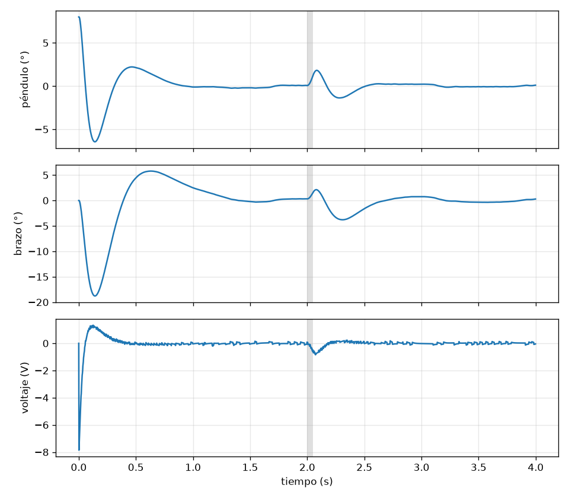

# Hoja de ruta

Setra está en construcción. La biblioteca ya se puede usar en simulación; lo que sigue es llevarla a un montaje real, un péndulo invertido rotatorio (de Furuta), y dejarla lista para microcontroladores.

## Biblioteca

- [x] PID con salida limitada, protección de la integral y adelanto
- [x] Filtros: paso bajo, bicuadrático y limitador de pendiente
- [x] Perfiles de movimiento trapezoidal y en S
- [x] Espacio de estados: discretización, regulador LQR y observador
- [x] Filtro de Kalman lineal
- [x] Plantas para simular: motor de corriente continua, péndulo y péndulo de Furuta
- [x] Módulo de Python con las mismas clases
- [ ] Compilar el núcleo para un microcontrolador y comprobar cuánto tarda cada bloque
- [ ] Pruebas automáticas al subir cambios
- [ ] Tipos para Python (`.pyi`), para que el editor complete y revise
- [ ] Perfil en S con velocidad inicial y final, para replanear en marcha
- [ ] Identificación: ajustar los parámetros de un modelo a partir de datos medidos

## Péndulo de Furuta

Un motor con encoder gira un brazo horizontal; en la punta, un segundo encoder hace de eje de un péndulo libre. El control lo levanta y lo sostiene hacia arriba.

### 1. Modelo y simulación

- [x] Modelo no lineal y su versión lineal alrededor de la vertical (`planta::Furuta`)
- [x] Equilibrio simulado con LQR y observador, con saturación del motor y resolución de los encoders (`python/ejemplos/furuta.py`)
- [ ] Cambiar los datos supuestos por los del motor, los encoders y las piezas reales
- [ ] Levantar el péndulo desde abajo con un control por energía y pasarlo al regulador al llegar arriba
- [ ] Añadir al modelo la holgura de la reductora y la fricción seca, que son lo que más separa la simulación del montaje

Con los datos supuestos (motorreductor de 12 V, brazo de 12 cm y péndulo de 20 cm y 20 g) la simulación dice que sostenerlo pide menos de 8 V y que el brazo se mueve unos 19° al corregir una desviación de 8°.

### 2. Datos del hardware

Lo que hay que anotar antes de diseñar nada:

- [ ] Placa: modelo exacto
- [ ] Motor: voltaje, relación de la reductora y pulsos por vuelta del encoder
- [ ] Driver del motor: modelo y corriente que aguanta
- [ ] Encoder del péndulo: tipo y pulsos por vuelta
- [ ] Fuente: voltaje y corriente

### 3. Mecánica

- [ ] Base que sujete el motor con el eje vertical y no se mueva con los tirones
- [ ] Brazo con el acople al eje del motor y el alojamiento del encoder en la punta
- [ ] Péndulo con su acople al eje del encoder
- [ ] Paso del cable del encoder del péndulo: limitar el giro del brazo o usar un anillo rozante
- [ ] Pesar y medir las piezas impresas para sacar masas, centros de masa e inercias

### 4. Firmware

- [ ] Elegir cómo corre Setra en la placa e instalar las herramientas que falten
- [ ] Leer los dos encoders en cuadratura por hardware
- [ ] Mover el motor con PWM, con sentido y freno
- [ ] Lazo de control a periodo fijo (1 kHz)
- [ ] Telemetría por serie hacia Python para graficar en vivo
- [ ] Seguridad: cortar el motor si el péndulo cae, si el brazo pasa de su límite o si se pierde la comunicación

### 5. Identificación

- [ ] Respuesta del motor a escalones de voltaje: resistencia, constante de par y fricción
- [ ] Oscilación libre del péndulo: centro de masa, inercia y fricción
- [ ] Comparar la simulación con lo medido y corregir el modelo

### 6. Control en el montaje

- [ ] Sostener el péndulo colocándolo a mano hacia arriba
- [ ] Levantarlo solo desde abajo
- [ ] Mover el brazo a una posición pedida sin que el péndulo caiga
- [ ] Medir cuánto empujón aguanta
