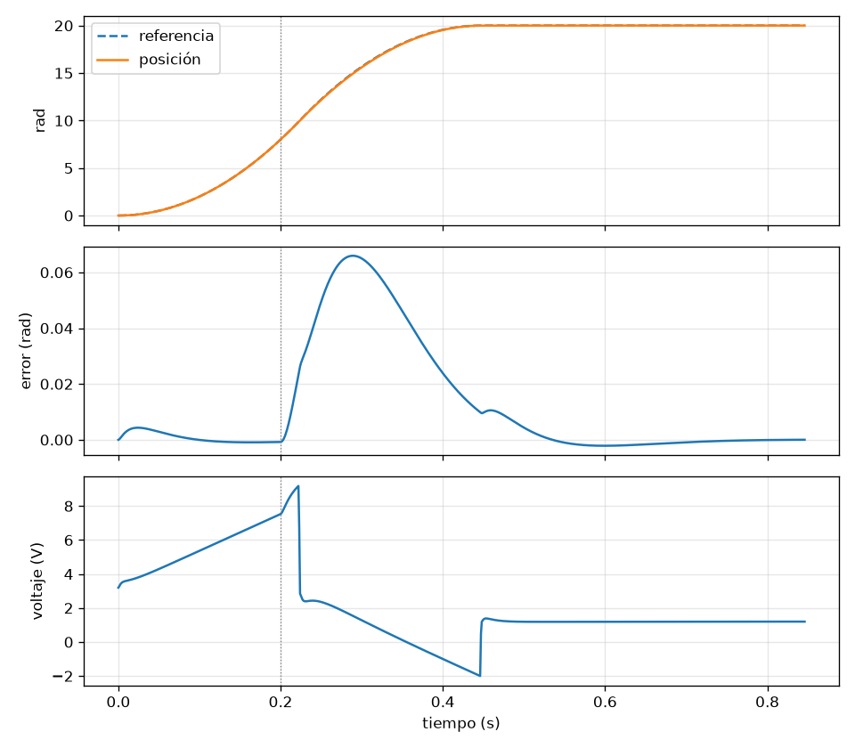

# Setra

Bloques de control para mecatrónica: PID, filtros, perfiles de movimiento, filtro de Kalman y modelos de plantas para simular. El nombre viene de *setpoint* y *trayectoria*.

El núcleo está escrito en Rust sin `std` ni memoria dinámica, así que el mismo código que se prueba en la computadora es el que corre en un microcontrolador. Encima lleva un módulo de Python para simular, sintonizar y graficar con las mismas clases.



## Qué trae

| Módulo | Contenido | Python |
|---|---|---|
| `pid` | PID con salida limitada, integral protegida contra la saturación, derivada filtrada (de la medida o del error) y entrada de adelanto | `Pid` |
| `filtro` | Paso bajo de primer orden, bicuadrático (paso bajo y rechaza banda) y limitador de pendiente | `PasoBajo`, `Bicuadratico`, `LimitadorPendiente` |
| `perfil` | Perfil trapezoidal de posición, con velocidad inicial y final para replanear en marcha, y perfil en S con el jerk limitado | `PerfilTrapezoidal`, `PerfilS` |
| `planta` | Motor de corriente continua, péndulo e integrador de Runge-Kutta de orden 4 | `MotorDc`, `Pendulo` |
| `kalman` | Filtro de Kalman lineal de tamaño fijo | `Kalman` (hasta 6 estados, 4 medidas y 4 entradas; acepta listas o arreglos de NumPy) |
| `matriz` | Matrices de tamaño fijo con producto, transpuesta e inversa | — |

El tiempo va siempre en segundos y cada bloque recibe su `dt`: nada depende de un reloj ni de una plataforma.

## En Python

Hace falta Rust para compilar el módulo. Dentro de `python/`:

```sh
uv venv
uvx maturin develop --uv --release
```

o, con `pip`, `pip install ./python` desde la raíz.

```python
from setra import MotorDc, Pid

DT = 1e-3
motor = MotorDc(resistencia=2.0, inductancia=2e-3, kt=0.05, ke=0.05, inercia=2e-4, friccion=1e-4)
pid = Pid(0.2, 4.0, salida_min=-12.0, salida_max=12.0)

for _ in range(1000):
    voltaje = pid.actualizar(150.0, motor.velocidad, DT)
    motor.paso(voltaje, DT, subpasos=20)

print(motor.velocidad)  # 150 rad/s
```

`python/ejemplos/motor_dc.py` genera la gráfica de arriba (necesita `matplotlib`): un perfil trapezoidal mueve el motor 20 rad y a los 0.2 s entra un par de carga.

## En Rust

```toml
[dependencies]
setra = { path = "../setra" }
```

```rust
use setra::pid::Pid;

let mut pid = Pid::nuevo(0.2, 4.0, 0.0)
    .con_limites(-12.0, 12.0)
    .con_filtro_derivada(1e-3);

// En cada ciclo de control, con la medida del sensor:
let velocidad = 0.0;
let voltaje = pid.actualizar(150.0, velocidad, 1e-3);
assert_eq!(voltaje, 12.0);
```

Los cálculos van en `f32`, que es lo que trae la unidad de coma flotante de casi cualquier microcontrolador. La característica `f64` cambia todo a doble precisión.

`cargo run --example motor_dc > motor.csv` corre el mismo lazo del ejemplo de Python y escribe los datos en CSV.

## Pruebas

```sh
cargo test                      # núcleo en f32
cargo test --features f64       # núcleo en f64
cd python && python -m pytest   # módulo de Python, ya instalado
```

## Licencia

MIT
